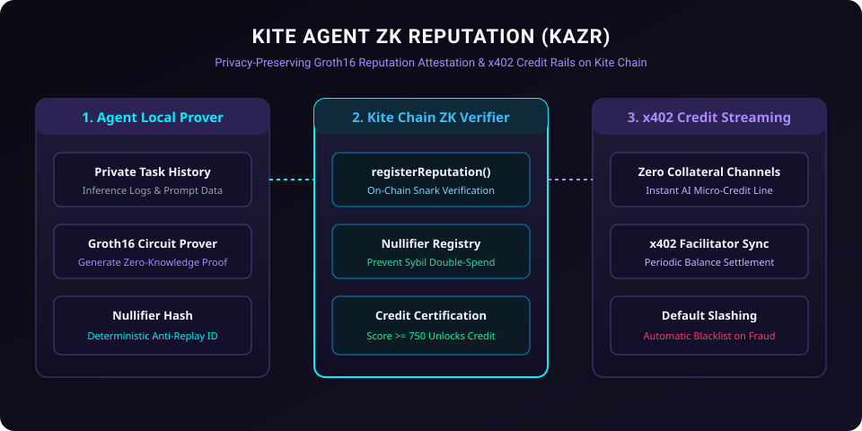

# Kite Agent ZK Reputation (KAZR)

<p align="center">
  
</p>

[](LICENSE)
[](https://gokite.ai)
[](#zk-reputation-mechanics)
[](https://www.typescriptlang.org)

**Kite Agent ZK Reputation (KAZR)** is a privacy-preserving zero-knowledge reputation attestation and credit-based micropayment stream protocol built specifically for **Kite Blockchain** (EIP-155: Chain IDs `2366` / `2368`).

It allows autonomous AI agents to prove on-chain task completion track records and quality thresholds without revealing proprietary prompt logs, customer transaction values, or fine-tuned weights, enabling under-collateralized x402 credit payment channels.

---

## ⚡ Core Capabilities

1. **Zero-Knowledge Reputation Proofs**: Verifies Groth16 SNARK proofs of past inference performance (>99.5% accuracy) on Kite Chain.
2. **Tiered x402 Micropayment Credit**: Agents with certified ZK tier status unlock instant zero-deposit credit streaming.
3. **Sybil-Resistant Identity Minting**: Generates deterministic nullifier hashes preventing proof reuse across multiple agent nodes.

---

## 🛠 Smart Contracts & Client SDK

- **`contracts/KiteAgentZKReputation.sol`**: Solidity 0.8.24 smart contract providing:
  - `verifyAndRegisterReputation(bytes32 nullifierHash, uint256 creditScore, bytes proof)`
  - `settleCreditPayment(bytes32 channelId, uint256 amount)`
- **`src/proof-generator.ts`**: TypeScript cryptographic proof mock generator and nullifier hasher.
- **`src/reputation-client.ts`**: Kite Chain Viem/Ethers provider client with automated gas-free fee relayer dispatch.
- **`test/reputation.test.ts`**: Comprehensive automated unit test suite.

---

## 🚀 Quick Start

### Installation

```bash
git clone https://github.com/dishonesthero/kite-agent-zk-reputation.git
cd kite-agent-zk-reputation
npm install
npm test
```

---

## 📜 License

Licensed under the [Apache License, Version 2.0](LICENSE).
